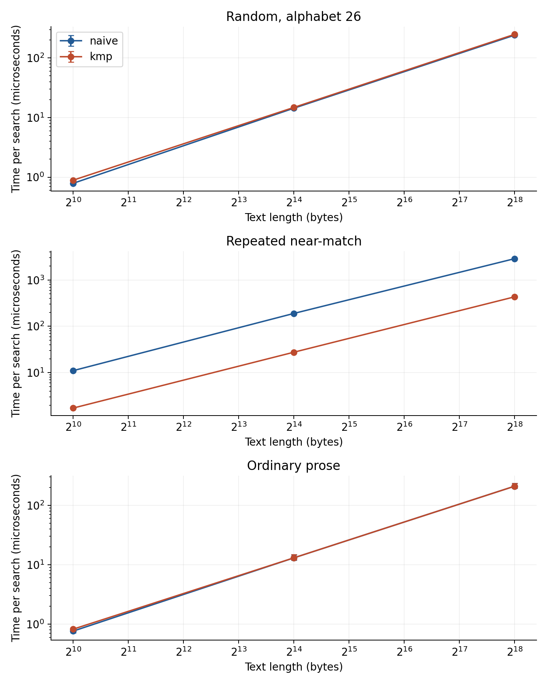
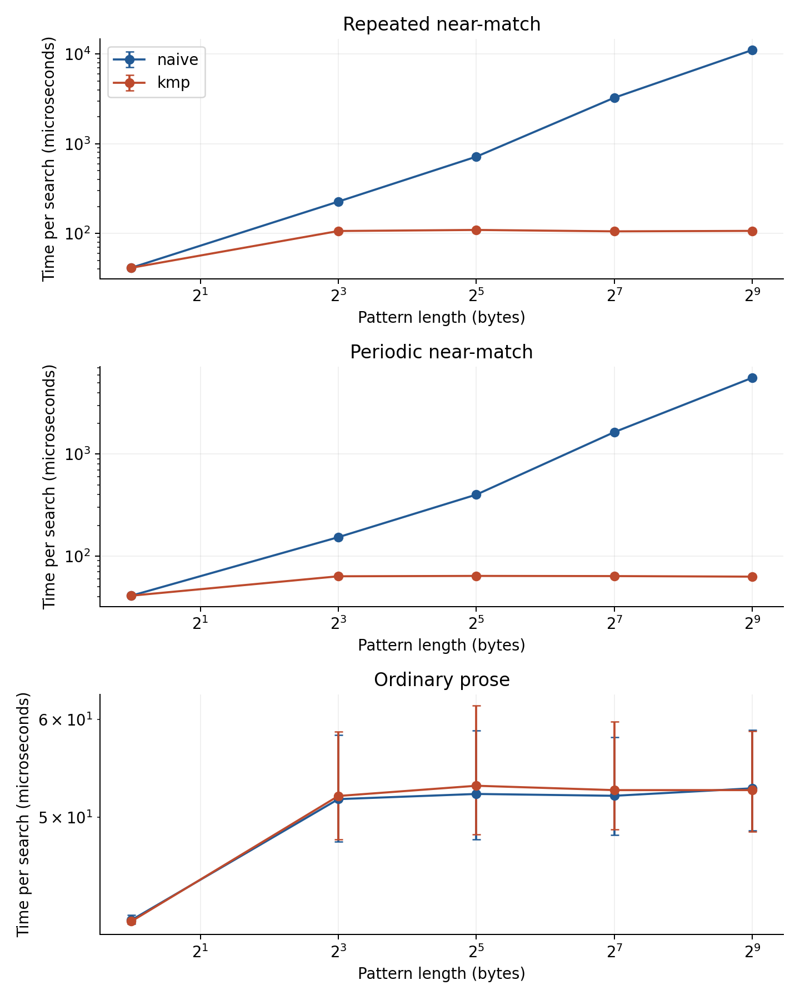
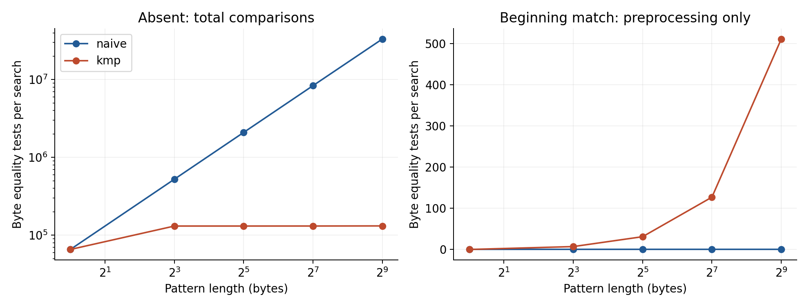
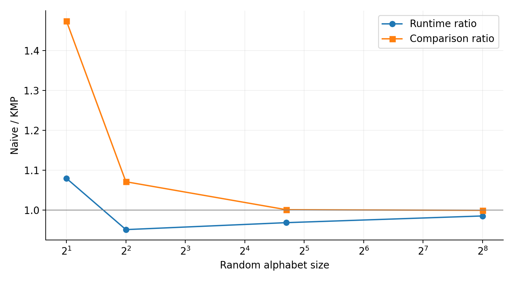
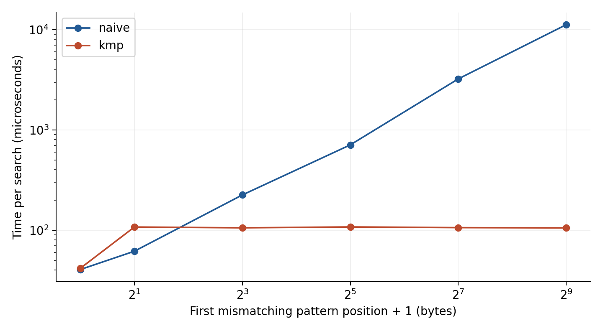

# First-occurrence byte search: naive search and KMP

Ethan Goldman

Advanced Algorithms 41052, Programming Assignment 2

27 October 2026

Technical report. The personal reflection and mandatory submission-only sections are maintained separately. This public document is not the complete submission package.

## Abstract

This project compares two C++17 algorithms for finding the first occurrence of a byte pattern in a byte text. Naive search tries each valid start and checks the pattern from the beginning. Knuth-Morris-Pratt, abbreviated KMP, constructs a table describing reusable pattern prefixes and uses it to avoid moving backward through the text. The comparison includes correctness checks, a bounded synthetic study, a small public-domain prose corpus, and a controlled follow-up. Main measurements use 363 instances and 6534 timed batches. They include the complete cost of constructing KMP's table on every call. On repeated text with a 512-byte near-match pattern, KMP is 104.48 times faster. On random and ordinary-text workloads the differences are much smaller. The follow-up finds that almost equal comparison counts can still accompany a substantial timing difference. The useful conclusion is conditional: KMP supplies a strong worst-case guarantee, while the benefit on a particular first-occurrence workload depends on pattern structure, stopping position and the work each comparison requires.

## 1. Problem and algorithms

### 1.1 The contract

The input is a text T of length n and a pattern P of length m. Both are sequences of bytes. The result is the smallest index s such that T[s+j] equals P[j] for every j from zero through m-1. If there is no such index, the result is std::string_view::npos. An empty pattern matches at zero, including when the text is empty. A nonempty pattern cannot match an empty text. If m exceeds n, both implementations return immediately. The algorithms take non-owning views and do not modify their inputs.

These details determine what can be compared fairly. Returning any occurrence would allow an algorithm to stop at a different answer. Searching for all occurrences would force continued work after a successful match. Here the first occurrence ends the search, so a text's total length is sometimes a poor description of the work actually performed. A match at zero can leave nearly all the text unexamined. This distinction becomes central when interpreting preprocessing overhead.

A byte index is not a Unicode character position. A multibyte UTF-8 character can occupy several indices, and a pattern can begin within such a representation. No normalization, case folding or character decoding is part of this problem. Embedded zero bytes are valid rather than terminators. The command interface consequently reads the text and pattern from binary files instead of relying on command-line strings that cannot reliably represent every byte sequence.

### 1.2 Naive search

Naive search considers start positions in increasing order from zero through n-m. At each start it compares P[0] with T[start], then continues until a mismatch or a complete match. After a mismatch it advances the candidate start by one and starts the pattern again. After m successful comparisons it returns the current start. This implementation uses ordinary equality comparisons in a loop. It does not call a library substring routine or use a separate byte-filter optimization.

For correctness, a candidate is rejected only when a required byte differs. A complete sequence of m equal bytes proves a match at that candidate. Every valid start is examined in increasing order, so the first returned start is the smallest valid one. When every candidate has been rejected, no valid start remains. The guard for m greater than n occurs before subtracting the unsigned sizes, preventing an underflow from creating an enormous invalid candidate range. With m equal to zero, the comparison loop is empty and the first candidate returns zero.

There are n-m+1 candidates when 0<m<=n. Each needs at most m comparisons, giving O((n-m+1)m) time and O(1) auxiliary space. The familiar O(nm) upper bound is convenient, but the more precise candidate count helps explain the measurements. For text consisting only of a and pattern a repeated m-1 times followed by b, every candidate matches a long prefix before failing. The count is exactly (n-m+1)m. This family makes the repeated work visible without depending on the chance of an accidental occurrence.

Worst-case bounds do not describe every run. A different first byte rejects a candidate after one comparison. A whole match at zero needs only m comparisons. Increasing the available text after that match changes neither the candidate sequence examined nor the result. These cases explain why a slower asymptotic upper bound does not establish a slower measured execution on every input.

### 1.3 KMP and the LPS table

KMP's extra information belongs to the pattern. For each pattern index i, lps[i] stores the length of the longest proper prefix of P[0..i] that is also a suffix of that same prefix. Proper means shorter than the complete prefix being considered. This information tells the search which already matched bytes can still form the beginning of another candidate after a mismatch. The original KMP paper establishes linear-time pattern matching [1]; the argument here concerns the particular first-occurrence implementation in this repository.

The construction starts with a zero-filled vector. The variable length describes the current candidate border, a prefix that is also a suffix of the pattern part already processed. When P[i] equals P[length], that border extends by one, so the new table entry is length+1. When the bytes differ and length is positive, the next possible shorter border has length lps[length-1]. The algorithm tries it without advancing i. When length is zero and the bytes still differ, there is no nonempty border to extend, so the table entry is zero and i advances.

For the pattern ABABAC, the complete table is [0,0,1,2,3,0]. At index four, the prefix ABABA has border ABA of length three. At index five, C first fails against B at index three. The table sends the candidate border length from three to one. C also fails against B at index one, then fails against A at zero. The final entry is therefore zero. This example includes multiple fallbacks during construction and illustrates why simply decrementing length once would not express the required border relationship.

The search tracks a text index i and a matched-prefix length matched. Immediately before the next comparison, P[0..matched) equals the text suffix ending just before i. Matching bytes increase both i and matched. Reaching matched=m proves a complete occurrence beginning at i-m, which is returned immediately. A mismatch with matched zero advances i because no part of the pattern has been matched at that text byte. A mismatch with matched positive changes matched to lps[matched-1] and retains i.

The retained suffix is valid because it is equal to a prefix of the pattern by the table definition. Any candidate that begins within the matched region and could still succeed must correspond to such a border. The longest border is the next candidate to try; further failures follow its own borders. This rules out skipping a viable earlier occurrence. The text index never decreases: fallback changes the interpretation of already matched text rather than rescanning the text from a previous index.

For text ABABABAC and pattern ABABAC, the search first matches five bytes. At text index five, B differs from pattern index five, C. Fallback changes matched from five to lps[4]=3 while i remains five. B now matches pattern index three. The remaining A and C complete the pattern and the answer is 8-6=2. Resetting matched to zero while keeping i would throw away a useful border and can miss that occurrence. Moving i backward would preserve correctness only with further care and would abandon the main efficiency property being studied.

### 1.4 Costs and correctness evidence

LPS construction takes O(m) time and O(m) auxiliary storage. Its index advances at most m-1 times, while every fallback strictly reduces a length previously increased by successful extensions. In the search, i advances at most n times. A positive matched value can increase only with a successful comparison and decreases on fallback. Charging each decrease to earlier increases bounds the additional comparisons by a linear amount. The complete call is O(n+m), including vector initialization, preprocessing and search. Early-return guards can finish in constant time. The vector contains m size_t entries; on the measured machine, a 512-byte pattern requires 4,096 bytes of element storage, excluding the small vector object and allocator metadata.

The ordinary and counted entry points instantiate the same algorithm bodies with a compile-time counting choice. This avoids maintaining a second algorithm merely to count work. Counting records byte equality tests, split into preprocessing and search. Loop conditions, integer comparisons, assignments and allocation are not included in that count. The primary timing build compiles the increments out.

The test suite checks 104,600 answers across ordinary and counted functions. It includes independently specified boundaries and examples, every pair among the 127 strings over {a,b} of length at most six, and 10,000 reproducible generated cases checked against std::string::find. Binary examples include zero and high bytes. Exact expected counts check the instrumentation itself. Warning-enabled, address-sanitized and undefined-behaviour-sanitized builds pass. Explicit failure checks also pass with NDEBUG, so disabling assertions cannot silently remove the tests. These checks support the implementation; the invariants above supply the general reasoning that finite tests cannot establish alone.

## 2. Theoretical comparison and original predictions

The dated prediction record was committed before the first performance pilot and remains unchanged in docs/predictions.md. Correctness testing had already occurred. The initial hypotheses were deliberately qualitative because there was no measurement basis for a precise crossover size. Naive search might compete on random data where most starts fail early. KMP should avoid substantial repeated work on long partial matches. Its preprocessing should matter when the search stops early. Periodic text alone was not expected to guarantee an advantage: the pattern and its actual first occurrence also matter.

For a simplified independent uniform alphabet of size sigma, the probability that a candidate survives its first k comparisons is approximately sigma to the power -k. Ignoring boundaries and conditioning introduced by constructing a particular occurrence, the expected comparisons per failing candidate resemble 1+1/sigma+1/sigma squared and further terms. This series approaches sigma/(sigma-1) for sigma greater than one. It suggests many short failed attempts on a large alphabet and more repeated comparisons on a small alphabet. It is a reasoning aid, not an exact fitted model for the conditioned benchmark instances.

KMP can reduce repeated equality tests but performs other work: maintaining its state, consulting the table after mismatches, and constructing the table before scanning. Its auxiliary storage is real even when the first match occurs immediately. Conversely, a table lookup can replace a long series of byte comparisons. Which effect matters depends on the particular pattern and stopping position. The experiment therefore varies both structure and lengths instead of searching for one universal winner.

The original record specifies potential refutations. Large-pattern near-matches should favour KMP, so a persistent naive win there would challenge the runtime expectation. Beginning matches test whether preprocessing remains material as m grows. Alphabet sweeps test whether reducing sigma improves KMP's relative result. Prose had no confident predicted winner. Its purpose is to check whether the synthetic extremes describe an ordinary example, not to establish a representative distribution of all real searches.

No hypothesis assumed that the standard library implements either project algorithm. It serves as an independent answer reference. Measuring it would introduce another implementation question and potentially hardware-specific optimizations, expanding the scope beyond the approved comparison. Similarly, precomputing LPS once and reusing it would answer a different workload question. Every measured KMP call here must construct its own table.

## 3. Experimental methodology

### 3.1 Inputs and controls

The main study has 121 configurations and three instances per configuration. The text-size sweep uses n=1,024, 16,384 and 262,144 with m=32. It includes random alphabets of 2, 4, 26 and 256 values and repeated, periodic and prose families. Each family has beginning, final-position and absent searches. The pattern-size sweep fixes n=65,536 and uses m=1, 8, 32, 128 and 512. It uses alphabet-26 random data plus the repeated, periodic and prose families. The random m=1 end and absent cases are omitted by design: a one-byte pattern from the same small alphabet is not reliably absent from such a long random text.

Python's seeded generator uses seeds 41052, 41053 and 41054. Random absent patterns are generated until the oracle confirms absence. An end instance is then formed from an absent pattern and is admitted only if its actual first index is n-m. This validation matters because merely inserting a pattern near the end does not rule out an earlier occurrence, including an occurrence crossing an insertion boundary. Every configuration checks the final bytes rather than trusting the construction label.

Repeated near-matches use a uniform text and a pattern ending in a different byte. Periodic near-matches alternate two text bytes and put a distinct final byte in the pattern. Beginning variants use an actual text prefix, so they succeed immediately rather than continuing the adversarial absent workload. The three seeds change byte labels for these structured families while preserving their comparison structure. They are three concrete instances, not three independent random structural samples.

The ordinary-text corpus contains 16,384 bytes beginning with the familiar opening sentence of Jane Austen's Pride and Prejudice. The 1813 novel and the catalogue's public-domain status were checked [3]. Three circular offsets form related prose windows, and longer inputs repeat the excerpt. For end and absent prose searches, a zero byte terminates a pattern derived from the text prefix, ensuring that an absent sentinel distinguishes it from the unmodified prose. This is a controlled search in ordinary text, not a claim to model the distribution of natural-language queries.

The committed manifest records family, lengths, alphabet parameter, mode, seed, expected answer and SHA-256 hashes of the exact text and pattern. The corpus is committed, so reproduction requires no download. Both algorithms receive the same immutable instance in one driver process. Repetitions of that instance estimate timing variation; different seeds or windows estimate variation across the specified instances. Those two sources are summarised separately.

### 3.2 Timing boundary and batching

The C++ driver surrounds only repeated complete algorithm calls with std::chrono::steady_clock. The standard specifies that this clock does not decrease or adjust [2]. Generation, file loading, process startup, correctness validation and printing are outside the timed window. KMP's vector allocation, zero initialization, LPS construction, scanning and vector destruction occur inside every call. The naive call has the same input views and returns through the same timing wrapper.

Each algorithm gets three single-call warm-ups, then calibration doubles the batch size until a batch reaches approximately one millisecond or 65,536 calls. Nine subsequent batches supply the main timing samples. Algorithm order alternates each repetition, with the seed determining which starts first. Calibration and warm-up rows remain in the raw CSV but do not enter the summaries. This prevents a slow first call or a calibration sample from being quietly treated as an ordinary measurement.

A batch calls an externally compiled search through a function pointer and accumulates its answers. The result is consumed and its expected checksum is verified after the end clock read. Compilation uses separate translation units without link-time optimization or pure-function annotations. Inspection of the optimized Apple Clang assembly confirmed that the indirect call remains inside the batch loop between the two clock reads. This is concrete evidence against hoisting in the measured build, although future compiler or flag changes should receive their own check.

Some extremely fast cases reach the call cap before the target duration. There are 878 such timed batches in the main data. They remain visible rather than being dropped or silently expanded. Their per-call times include loop and function-call overhead and should not support tiny absolute speed claims. The slower long-scan comparisons are much less sensitive to that fixed overhead. No timer-overhead subtraction is applied, since subtracting another noisy estimate can create misleading precision.

### 3.3 Environment, summaries and limits

Measurements ran on an Apple M1 Pro MacBookPro18,3 with 16 GiB memory, macOS 27.2 on arm64, and Apple Clang 21.0.0. The optimized flags were -std=c++17 -Wall -Wextra -Wpedantic -O2. The main source revision is fdbcd1b. Environment files retain compiler output, clock, flags, seeds, raw elapsed units and run status. A separate hardware record supplies model and memory because the automatic sandboxed query could not read them. The machine was a shared desktop environment without frequency pinning or hardware-counter monitoring.

For each instance, elapsed nanoseconds are divided by batch size and the median of its nine timed batches is taken. Its interquartile range, or IQR, uses inclusive linear interpolation at the 25th and 75th percentiles. Each configuration then reports the median and IQR of its three instance medians. The plotted error bars describe that across-instance spread. Within-instance quartiles remain in instance-summary.csv. Neither spread is a confidence interval, and three instances are too few to justify broad population inference.

The complete main run contains 15482 retained rows, including calibration and warm-up. The 6534 timed batches belong to 363 validated instances. Driver processes have a 30-second timeout, the run has a 15-minute budget, and the maximum generated text is 262,144 bytes. All planned main instances completed. Pilot data remain separately labelled. A local Linux run was unavailable because the Docker daemon was not running; portable commands and a Linux CI workflow are provided, and only observed CI outcomes should be added to the verification record.

## 4. Results and analysis

### 4.1 Scaling the amount of text

Figure 1. Absent patterns of length 32. Points are medians of three instance medians; bars are their IQR. Each instance has nine timed batches. Both axes use logarithmic scales.

At fixed m=32, increasing n generally increases the absent-search runtime for both algorithms. On repeated text at n=262,144, naive takes 2878.210 microseconds and KMP takes 432.520 microseconds, giving a runtime ratio of 6.65. Their comparison counts are 8,387,616 and 524,318, respectively. This supports the structural explanation: naive repeatedly checks nearly the complete pattern at each candidate, whereas KMP retains valid prefix information after mismatches.

The fixed-pattern qualification is essential. Naive's worst-case bound contains both n and m, but when m stays at 32 its cost is still proportional to n with a larger constant. A straight rising line in a text-size plot therefore cannot distinguish O(n) from O(nm) without stating which variable is held fixed. The pattern-size sweep supplies that missing comparison. Calling this plot evidence that naive is universally quadratic would be an incorrect interpretation of the experiment.

Random alphabet-26 absent inputs at n=262,144 give 241.521 microseconds for naive and 249.271 for KMP. The ratio is 0.97, and the comparison counts are almost equal: 272,751 versus 272,403. This is consistent with early mismatches limiting naive's repeated work. It does not establish a universal advantage of several percent: such small differences belong to the measured implementation, machine and instances.

For the prose absent searches at the same lengths, the medians are 209.474 and 209.396 microseconds. Across-instance IQRs are 193.810-234.169 and 194.933-235.104 microseconds. Their overlap makes a strong winner claim inappropriate. Different windows contain different prefix structure and the sample covers one repeatedly extended excerpt. The result supports a narrow statement: this ordinary-text construction does not display the dramatic separation seen in the repeated near-match family.

### 4.2 Pattern length and repeated work

Figure 2. Absent searches at n=65,536. For m greater than one, the repeated and periodic patterns mismatch after partial matches. Prose uses the documented sentinel construction. Error bars have the same definition as Figure 1.

The repeated and periodic families show a growing KMP advantage as m increases. At m=512 in repeated text, naive takes 11143.000 microseconds per search and KMP takes 106.656. Their across-instance IQRs are 11135.450-11203.200 and 106.227-107.307 microseconds. The 104.48 runtime ratio is large enough that minor batch overhead or the observed spread cannot plausibly turn it into a close contest. It still describes a deliberately adversarial case rather than an average application workload.

Figure 3. Left: total equality tests for repeated absent searches, including preprocessing. Right: preprocessing equality tests for repeated beginning matches. These counts are deterministic per instance and are separate from primary timing.

For repeated absence, naive's exact formula gives (65,536-512+1)*512=33,292,800 comparisons. KMP uses 131,582 total comparisons. For m>1, its preprocessing count in this family is 2m-3 and its search count is 2n-m+1. The combined count is 2n+m-2. The analysis script checks these formulas against every relevant recorded instance, supplying a discriminating check of the explanation rather than merely assigning a familiar complexity label to a plot.

The comparison ratio is 253.02, substantially larger than the runtime ratio. A byte equality test is not a complete unit of execution cost. KMP and naive make different state updates, access different data, and execute different control paths around their equality tests. Counts establish that repeated work was removed, but converting their ratio directly into a time prediction would overstate the evidence.

### 4.3 Stopping position and alphabet size

For a repeated beginning match at m=512, naive needs exactly 512 search comparisons and no preprocessing. KMP needs 511 preprocessing comparisons for the all-equal successful pattern, followed by 512 search comparisons. The recorded total is 1,023. Its median complete-call time is 0.506 microseconds, compared with 0.171 for naive. This supports the preprocessing hypothesis without pretending that the measurement separately isolates allocation time from table construction. Both are included in the complete call.

End and absent instances require a much longer scan than beginning instances. In the repeated near-match construction they differ only in whether the final pattern eventually succeeds, so their work is similar. In random inputs, actual first-position validation is particularly important. Without it, a supposed end match might stop early and make either algorithm appear unexpectedly fast. The manifest and driver check every admitted instance independently of its descriptive filename.

Figure 4. Naive divided by KMP for absent random searches at n=262,144, m=32. A ratio above one favours KMP. The count ratio includes preprocessing. These are ratios of configuration medians, not confidence bounds.

For the binary alphabet, naive uses 523,816 comparisons and KMP uses 355,404, a ratio of 1.47. Their median times are 1088.710 and 1008.210 microseconds, a ratio of only 1.08. The binary case improves KMP's relative position compared with alphabet 26, while its runtime benefit is much smaller than the count reduction. The timing ratios are not monotonic across all four alphabet settings: alphabet 4 favours naive more than alphabet 26 does. Different random patterns and control paths prevent alphabet size alone from determining the measured ordering. Larger alphabets generally make candidate checks fail quickly, but this sweep does not establish a universal crossover or a monotonic runtime rule.

## 5. A specific surprise and a controlled explanation

The original qualitative hypotheses broadly hold, so there is no claimed reversal of them. The useful unresolved observation was the gap between comparison ratios and runtime ratios. After seeing the main data, a separate dated follow-up prediction was committed. It asked whether almost equal comparison counts on a controlled repetitive family would produce similar runtimes. Its timing and origin remain explicit in docs/followup-prediction.md; it is not presented as an original pre-study belief or as an unrecorded personal experience.

The follow-up fixes n=65,536 and m=512 and uses an otherwise all-a pattern with one b. The b moves through zero-based positions 0, 1, 7, 31, 127 and 511. Every pattern is absent from the all-a text. Three byte-label variants and nine timed repetitions per instance retain the existing driver and timing boundary. This changes where the mismatch occurs while holding overall lengths and successful prefix bytes under direct control.

Figure 5. Timing against the first mismatching pattern position plus one, using logarithmic axes. Points are configuration medians. The exact numerical summaries and across-instance quartiles are retained in mismatch-summary.csv.

At position one, naive performs 130,050 equality tests and KMP performs 132,091, differing by about 1.6 percent. Nevertheless, naive takes 61.691 microseconds and KMP takes 107.511. KMP is 1.74 times slower. Their across-instance IQRs are 61.319-61.781 and 107.373-107.688 microseconds, respectively. The ranges are well separated, making this a concrete disagreement with the new similar-runtime prediction rather than an interpretation of nearly overlapping noise.

The counters admit independent checking. Naive tries 65,025 valid candidates and fails on its second comparison at each, giving 130,050. KMP makes 131,071 search comparisons and 1,020 preprocessing comparisons. After its first successful a, each subsequent a first fails against b at pattern index one. KMP falls back to index zero and compares that same text byte again. It preserves a correct invariant, but this path performs state changes and table accesses that a count of equality tests does not represent.

The timing units, complete-call boundary, absence, inputs, optimized build and expected counts were checked before accepting the observation. At mismatch position zero both searches reject bytes immediately and their times are close. At later mismatch positions naive's work grows with the prefix length while KMP's stays bounded by its linear mechanism, and the advantage changes direction. This supports a cost model that includes both the number of tests and the work surrounding them. It does not establish that branch prediction, cache misses or allocation is the dominant processor-level cause. Those explanations remain unmeasured.

Final verification found that a rapid driver edit had shared the executable's timestamp, so Make had skipped a rebuild. The missing checksum validation was outside timing, but source and executable did not agree exactly. Both studies were therefore recollected after forced compilation; the final collector records source and executable hashes. The original runs remain as superseded evidence, and the original predictions remain unchanged. This replacement collection verifies the workflow after results were known rather than constituting another blind prediction test.

## 6. What to investigate next

The next useful experiment would separate one-shot searches from many texts searched with the same pattern. A reused LPS table could spread preprocessing over many calls. That requires a deliberately different interface and timing boundary, so adding it casually to this comparison would be misleading. A future study should report both total workload cost and per-search cost for a specified number of texts, keeping the first-occurrence contract unchanged.

Another useful direction is a larger, more diverse set of natural text and binary corpora with legally reusable content. The present prose experiment has three related windows and artificial absent patterns containing a sentinel. It demonstrates behaviour on that construction, not the frequency of long partial matches in ordinary user queries. Genuine query samples would need a documented selection method, actual first-match positions and enough independent documents to separate corpus variation from timing noise.

Compiler and machine sensitivity also deserve attention. The optimized source contains small loops, and a different compiler could change their constant factors. Repeating the same fixed input instances on Linux and another processor would test whether the large adversarial advantage and the equal-comparison surprise persist. Assembly inspection and independently checked answers should accompany such changes. Processor-level causes would require suitable profiling or counters rather than a speculative explanation attached to the existing timings.

Within the current scope, the practical choice is conditional. Use KMP when its linear worst-case guarantee and protection from repeated prefixes matter. A short naive implementation remains reasonable for small or quickly rejected one-shot searches. This study supplies evidence about the regimes and mechanisms, rather than a recommendation to replace a production standard-library routine. No universal text length, pattern length or alphabet cutoff follows from these samples.

## 7. Individual ownership, evidence and submission scope

Ethan Goldman is the sole student submitter and the primary owner responsible for explaining both algorithm modules under the approved individual arrangement. The repository records genuine milestones: the existing implementation baseline, predictions before timing, expanded validation and the harness, the pilot, the main raw study, and the controlled follow-up. The history is not a reconstruction of fictional intermediate attempts. No incorrect search answer was observed during the executed checks, and no failed algorithm run is invented as a learning story.

The technical evidence covers algorithms, command handling, generation, environment records, raw measurements, analysis and figure regeneration. A separate individual reflection must describe the student's actual experience, including a specific design decision or bug, what would change next time, and an example of improved understanding. Those personal claims require the student's review. Responsibility for the implementation and presentation does not establish unaided authorship or demonstrated understanding by itself.

Reproduction has two separate meanings. Running the analysis rebuilds tables and figures from committed measurements and should preserve their numerical contents. Rerunning the benchmark creates a new directory and new noisy timing samples. The original data are never overwritten by default. The README provides commands for both paths, including a bounded smoke run for checking the workflow without repeating the full experiment. Editable report text and slide content remain with the exported artifacts.

This public technical report excludes the mandatory submission-only disclosure and personal reflection. The private submission package must add and review those sections, record the final video duration, and include the real peer-viewing responses when assigned. Preparing figures, slides and a script does not complete the video requirement. No submission, peer viewing or independent human rehearsal is claimed here. The final result is a reproducible technical comparison and a prepared basis for the remaining individual work.

## References

[1] Knuth, D. E., Morris, J. H., Jr., and Pratt, V. R. (1977). Fast Pattern Matching in Strings. SIAM Journal on Computing, 6(2), 323-350. https://doi.org/10.1137/0206024. Publisher metadata and abstract checked 27 October 2026. The correctness argument in this report follows the actual LPS implementation rather than reproducing the paper's notation.

[2] ISO C++ working draft. [time.clock.steady], Class steady_clock. https://eel.is/c++draft/time.clock.steady. Accessed 27 October 2026. Used for the monotonic-clock specification.

[3] Project Gutenberg. Pride and Prejudice, by Jane Austen, ebook 1342. https://www.gutenberg.org/ebooks/1342. Accessed 27 October 2026. Catalogue identifies Austen's dates as 1775-1817 and the text as public domain in the USA. Exact excerpt provenance and hashes are recorded with the data.
